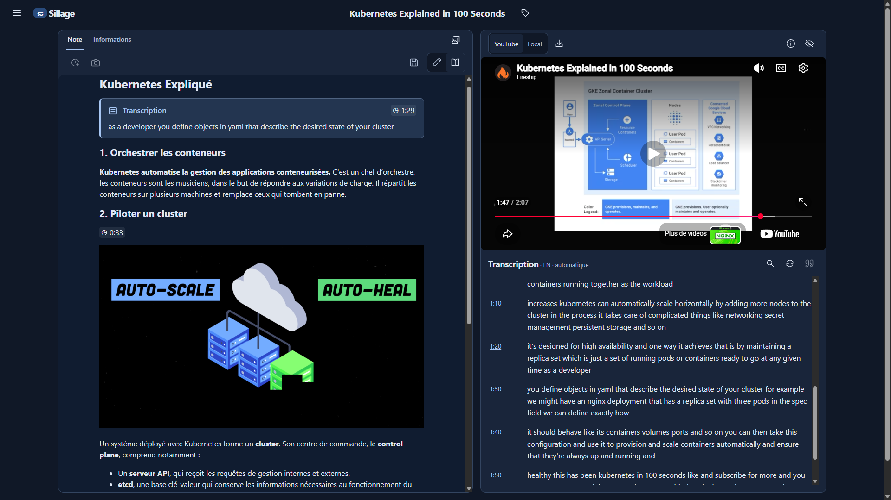
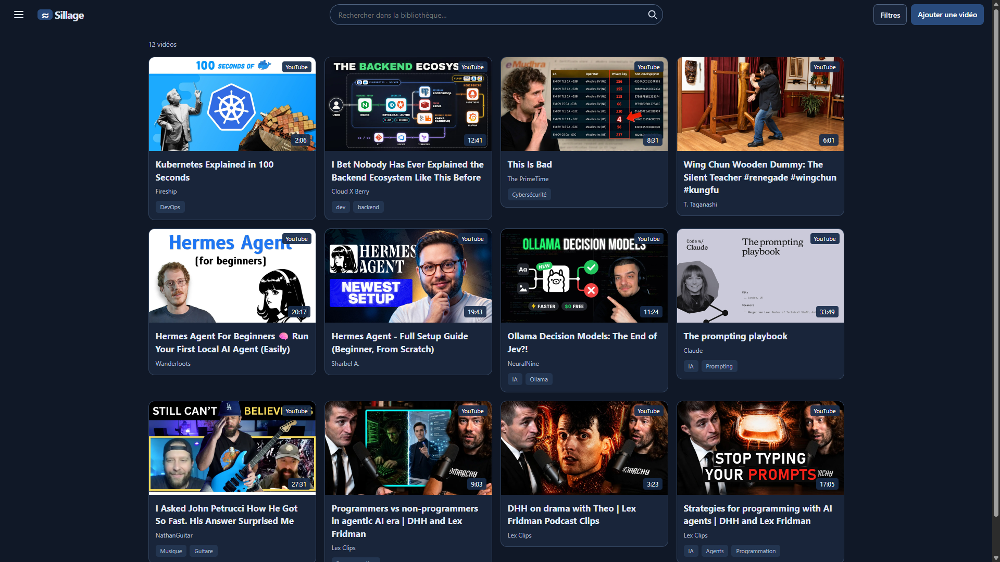
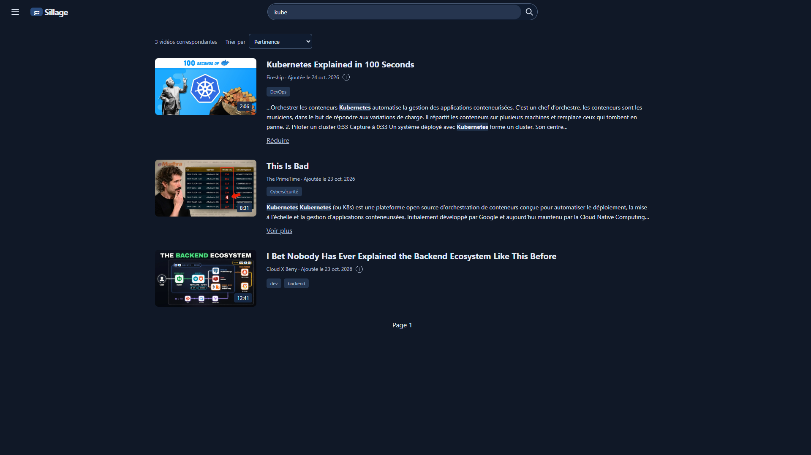

**Application web auto-hébergée · Projet personnel en développement actif**

Je développe **Sillage** pour transformer ma veille vidéo en connaissances consultables : notes Markdown, transcriptions, captures et références temporelles, réunies dans un même espace de travail.

Ce projet me permet de travailler sur **l'ensemble du cycle applicatif** : conception du modèle métier, backend **Go**, interface **React/TypeScript**, authentification, tests automatisés et déploiement **Docker**. Je prends en charge les choix d'architecture et leur mise en œuvre, ainsi que la documentation nécessaire pour installer et exploiter l'application.

**État actuel :** bibliothèque YouTube et espace de travail opérationnels, recherche plein texte, authentification locale/OpenID Connect et accès MCP en lecture seule. L'IA intégrée reste une évolution future.


Voir le projet sur GitHub


## L'application en pratique

Le besoin de départ est simple : retrouver une explication technique après avoir regardé une vidéo, sans devoir la parcourir à nouveau. Sillage permet d'ajouter une URL YouTube, d'en récupérer les métadonnées avec `yt-dlp`, puis de classer la vidéo par tags.

Chaque vidéo possède un espace de travail qui réunit :

- **Un éditeur Markdown** avec aperçu du formatage, barre d'outils et sauvegarde automatique.
- **Une transcription interactive** acquise depuis les sous-titres automatiques YouTube, avec recherche dans le texte et navigation vers le passage correspondant.
- **Des références temporelles et des captures** pour documenter les passages utiles et y revenir depuis les notes.
- **Un lecteur distant ou local** : une vidéo peut être téléchargée sur le serveur hébergeant Sillage, puis lue dans le navigateur sans dépendre de sa disponibilité sur YouTube.

La **recherche globale** porte sur les métadonnées des sources, les tags directement associés aux vidéos et les notes. Elle permet notamment de retrouver un concept absent du titre. Elle n'indexe pas les transcriptions : la recherche dans une transcription ouverte constitue une fonction distincte.

## Deux problèmes techniques résolus

### Éviter l'écrasement de notes entre plusieurs onglets

La sauvegarde automatique doit tenir compte des modifications concurrentes. Si deux onglets affichent la même note, une sauvegarde fondée sur une ancienne version pourrait effacer le travail déjà enregistré dans l'autre.

Chaque écriture transmet donc une **révision attendue**, comparée atomiquement en base. Une révision périmée provoque un conflit au lieu de remplacer silencieusement le contenu. Cette règle est portée par le contrat de persistance et reste indépendante du client HTTP.

Voir le [service de notes](https://github.com/patrickbrouhard/sillage/blob/master/internal/note/note.go) et les [règles de concurrence du modèle métier](https://github.com/patrickbrouhard/sillage/blob/master/docs/02-domain-model.md).

### Préserver les connaissances indépendamment des fichiers vidéo

Une vidéo téléchargée peut être volumineuse et devoir être supprimée. Cette suppression ne doit pas entraîner la perte des notes, transcriptions ou captures constituées pendant le visionnage.

J'ai séparé l'identité de la vidéo, sa provenance et son fichier physique. Les captures possèdent également leur propre identité : retirer une image du Markdown ne supprime pas son fichier, et le catalogue permet de la retrouver pour la réinsérer.

Un incident peut interrompre l'enregistrement entre la création d'un fichier et son référencement dans la base de données. Ces fichiers sont conservés par prudence pour éviter de perdre des données utiles, notamment après la restauration d'une sauvegarde. Il n'existe pas encore de mécanisme pour les récupérer ou les rattacher à la base.

---

## Architecture et choix techniques

Les services applicatifs Go portent les opérations métier. L'**API REST**, utilisée par l'interface web, et l'**adaptateur MCP**, destiné aux assistants et agents IA, s'appuient sur ces mêmes services pour éviter de dupliquer les règles.

La persistance SQLite, le système de fichiers et les outils médias sont isolés derrière des interfaces ciblées. Cette organisation s'inspire de l'architecture hexagonale : elle permet de tester les comportements métier sans dépendre systématiquement de YouTube ou d'un outil externe réel.


flowchart TB
    WEB["Interface Web React · TypeScript"]
    AGENT["Assistants et agents IA"]

    REST["API REST Go · Chi"]
    MCP["Adaptateur MCP Lecture seule"]

    SERVICES["Services applicatifs Go Vidéos · Notes · Transcriptions Médias · Captures · Recherche"]

    PORTS["Ports / interfaces"]

    DB[("SQLite FTS5")]
    FS["Système de fichiers"]
    MEDIA["yt-dlp ffmpeg · ffprobe"]

    WEB -->|HTTP| REST
    AGENT -->|MCP authentifié| MCP

    REST --> SERVICES
    MCP --> SERVICES

    SERVICES --> PORTS

    PORTS --> DB
    PORTS --> FS
    PORTS --> MEDIA


### Un modèle métier indépendant des plateformes

- **`Video`** représente l'objet de connaissance auquel les notes sont rattachées.
- **`VideoSource`** conserve la provenance et ses métadonnées, actuellement issues de YouTube.
- **`MediaFile`** représente les octets conservés sur le serveur, sans créer une nouvelle vidéo dans la bibliothèque.

Cette distinction prépare l'accueil d'autres sources, tout en limitant les intégrations actuelles à YouTube.

Les références temporelles des notes sont des **liens Markdown enrichis** : leur URI contient les identifiants de la vidéo et de sa source, ainsi que la position en millisecondes. Elles conservent la provenance du passage cité ; les annotations structurées distinctes du Markdown restent une évolution future.

### Des choix techniques adaptés au projet

| Choix | Intérêt pour le projet |
| --- | --- |
| **Go et Chi** | Backend HTTP léger, services métier testables et distribution sous forme de binaire. |
| **React, TypeScript et CodeMirror 6** | Interface interactive et édition Markdown avec gestion explicite des états de sauvegarde et de lecture. |
| **SQLite et FTS5** | Stockage relationnel et recherche plein texte sans serveur de base de données supplémentaire. |
| **yt-dlp, ffmpeg et ffprobe** | Acquisition et traitement des médias confiés à des outils spécialisés. |
| **Docker Compose** | Installation regroupant l'application et ses outils, avec configuration et données persistantes explicites. |

---

## Déploiement, tests et sécurité

### Préparer l'installation et l'exploitation

Le packaging Docker couvre la construction, les permissions et la conservation des données :

- **Construction en plusieurs étapes** pour compiler le frontend et le backend, puis assembler l'image avec les outils médias. Les images de base sont épinglées par empreinte ; les téléchargements de `yt-dlp` et Deno sont vérifiés par SHA-256.
- **Exécution avec privilèges limités** : utilisateur non root, capacités Linux retirées et option `no-new-privileges`.
- **Provisionnement déclaratif** pour initialiser une installation sans interaction, avec un fichier de configuration et un secret monté en lecture seule. La rotation du mot de passe est documentée.
- **Exploitation** : logs JSON avec rotation, données persistantes séparées de l'image et procédure de sauvegarde à froid/restauration couvrant la base et les fichiers associés.

Les détails sont consultables dans le [Dockerfile](https://github.com/patrickbrouhard/sillage/blob/master/deployments/docker/Dockerfile), le [fichier Compose](https://github.com/patrickbrouhard/sillage/blob/master/deployments/docker/compose.yaml), la [configuration déclarative](https://github.com/patrickbrouhard/sillage/blob/master/docs/configuration.md) et les [procédures d'exploitation](https://github.com/patrickbrouhard/sillage/blob/master/README.md).

### Automatiser les validations

Les workflows **GitHub Actions** exécutent plusieurs niveaux de vérification à chaque push ou pull request ciblant `master` :

- **Go** : tests, analyse `go vet`, compilation et détecteur de courses sur plusieurs packages.
- **API** : scénarios Postman déterministes pour vérifier les contrats HTTP.
- **Interface web** : compilation de production et tests navigateur Playwright, avec conservation des diagnostics.
- **Distribution Docker** : construction de l'image, vérification des outils et de la persistance, puis tests du provisionnement déclaratif et de la rotation des secrets.

Les scénarios automatisés contrôlent les dépendances externes lorsque nécessaire. Des essais manuels ciblés complètent ces tests pour les interactions avec l'iframe YouTube réelle et les lecteurs médias.

Voir le [workflow API et web](https://github.com/patrickbrouhard/sillage/blob/master/.github/workflows/api-tests.yml) et le [workflow Docker](https://github.com/patrickbrouhard/sillage/blob/master/.github/workflows/docker-tests.yml).

### Contrôler les accès

L'application propose une authentification locale et une intégration **OpenID Connect (OIDC)**. Les mutations de l'API REST sont protégées par les sessions web, un jeton CSRF et des contrôles d'origine. L'accès MCP utilise des clés API dédiées et reste limité à la lecture.

Le déploiement Compose de base publie le port sur **`127.0.0.1`**. L'exposition HTTPS dans un homelab reste une étape distincte du projet. Ces choix et limites sont décrits dans la [documentation de sécurité](https://github.com/patrickbrouhard/sillage/blob/master/docs/security.md).

---

## Bilan et prochaines étapes

Sillage me fait travailler sur des sujets qui dépassent l'ajout de fonctionnalités : **protéger les données utilisateur, gérer les accès concurrents, tester les frontières techniques et préparer l'exploitation**. Je développe le projet par incréments fonctionnels, avec des décisions documentées sur le modèle métier, l'architecture et les parcours utilisateur.

Cette démarche relie mon intérêt pour le **développement backend** aux pratiques **DevOps** : concevoir un comportement, le vérifier automatiquement, puis fournir les moyens de l'installer et de le maintenir.

Le socle est opérationnel et le projet reste en développement actif. Les prochaines pistes concernent l'enrichissement par l'IA, de nouvelles sources vidéo et les outils d'organisation. L'application reste utilisable sans IA.

Consulter le [code et la documentation sur GitHub](https://github.com/patrickbrouhard/sillage), ainsi que la [feuille de route](https://github.com/patrickbrouhard/sillage/blob/master/docs/05-roadmap.md).
